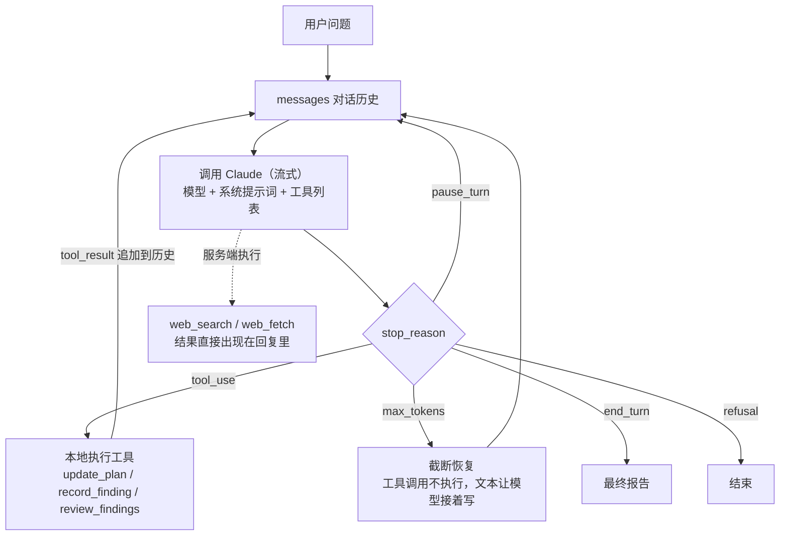

# Research Agent：深度研究 Agent

给它一个问题，它会自己**拆解问题 → 联网搜索 → 阅读网页 → 记录证据 → 交叉核实**，最后输出一份**带引用来源的研究报告**。

基于 [Claude API](https://platform.claude.com/docs) 和官方 Python SDK `anthropic`，**不依赖 LangChain 等 Agent 框架**。Agent 的主循环、工具调度、错误恢复都是手写的，代码量小，适合用来理解 Agent 是怎么运转的。

```text
$ research-agent "2026 年国内 AI Agent 方向的实习岗位，对技能有什么要求？"

──────────────── 第 1/30 轮 ────────────────
💭 先把问题拆成几个方向：招聘公司、岗位职责、技能要求、面试形式……
研究计划
 ◐ 1. 哪些公司在招 AI Agent 实习生
 ○ 2. 岗位职责通常包括什么
 ○ 3. 技能要求：语言、框架、模型相关知识
 ○ 4. 面试考察重点
🔍 搜索 AI Agent 实习 招聘 2026
   找到 10 条结果
📄 阅读 https://...
📝 已记录发现 #1（笔记中共 1 条） ……
```

## 功能

- **自主规划**：先把大问题拆成 3 到 6 个子问题，过程中实时更新每个子问题的进度。
- **联网检索**：用 Claude 的服务端工具 `web_search` 搜索网页、`web_fetch` 读取全文。
- **证据笔记**：每条关键发现都连同原文摘录和来源 URL 记进笔记，写报告时按编号引用。
- **报告输出**：Markdown 格式，结构为核心结论、正文、不确定性与局限、参考来源。
- **过程可见**：终端里实时显示思考摘要、搜索词、读取的网页和记录的发现。
- **成本可控**：限制最大轮数和每轮搜索次数，统计 token 用量和预估费用，开启提示词缓存。
- **出错能恢复**：工具参数不合法时把错误返回给模型让它自己修正；输出被截断时让它接着写；预算快用完时提醒它收尾；模型拒答时自动切换备用模型。

## 快速开始

需要 Python 3.10 及以上，以及一个 [Anthropic API Key](https://platform.claude.com/settings/keys)。

```bash
git clone https://github.com/ByteYuan227/research-agent.git
```

```bash
cd research-agent && python -m venv .venv && source .venv/bin/activate
```

```bash
pip install -e .
```

```bash
export ANTHROPIC_API_KEY=sk-ant-...
```

```bash
research-agent "2026 年国内 AI Agent 方向的实习岗位，对技能有什么要求？"
```

报告保存在 `reports/<时间>-<问题>/` 目录下：

| 文件 | 内容 |
|---|---|
| `report.md` | 最终研究报告 |
| `findings.json` | 研究计划、全部发现、来源列表、token 用量和预估费用 |
| `transcript.json` | 完整的对话记录，加 `--save-transcript` 才会生成，调试时有用 |

### 常用参数

| 参数 | 默认值 | 说明 |
|---|---|---|
| `--effort` | `high` | 思考力度，可选 `low` `medium` `high` `xhigh` `max`。越高越仔细，也越贵 |
| `--max-turns` | `30` | 最多调用模型的轮数，是控制成本最直接的参数 |
| `--searches-per-turn` | `5` | 每轮最多搜索次数 |
| `--fetches-per-turn` | `5` | 每轮最多读取的网页数 |
| `--model` | `claude-opus-5-5` | 模型 ID |
| `--hide-thinking` | 关 | 不显示思考摘要 |
| `--no-fallbacks` | 关 | 关闭拒答时自动切换备用模型 |
| `-o` | `reports` | 输出目录 |

### 费用

调用 Claude API 按用量计费，和 Claude Pro/Max 订阅是两套账单。一次研究的费用主要取决于轮数和读取的网页数量，运行结束时终端会显示本次的 token 用量和预估费用。想先低成本试一下，可以这样跑：

```bash
research-agent "你的问题" --effort medium --max-turns 10
```

## 它是怎么工作的



核心就是 [`research_agent/agent.py`](research_agent/agent.py) 里的一个循环：

1. 把对话历史 `messages` 发给 Claude，带上系统提示词和工具定义。
2. Claude 的回复里可能有：
   - **服务端工具调用**（`web_search`、`web_fetch`）：在 Anthropic 的服务器上执行，结果已经包含在回复里，本地什么都不用做。
   - **客户端工具调用**（`tool_use`）：由我们在本地执行，再把结果作为 `tool_result` 发回去。
3. 把 Claude 的回复**原样**追加到历史，再追加工具结果，然后进入下一轮。
4. Claude 不再调用工具、直接输出文字时，这段文字就是最终报告。

### 两类工具

| 工具 | 在哪执行 | 作用 |
|---|---|---|
| `web_search` | Anthropic 服务器 | 搜索网页 |
| `web_fetch` | Anthropic 服务器 | 读取网页全文，带引用定位 |
| `update_plan` | 本地 | 创建或更新研究计划（子问题和状态） |
| `record_finding` | 本地 | 记录一条发现：结论、证据摘录、来源、可信度 |
| `review_findings` | 本地 | 按子问题汇总全部发现并给来源编号，写报告前调用 |

本地工具都操作同一个 `Notebook` 对象，它就是 Agent 在这次研究中的工作记忆，代码在 [`research_agent/tools.py`](research_agent/tools.py)。

## 设计要点

这些是写这个 Agent 时做的具体取舍，也是理解 Agent 工程的关键点：

1. **对话历史只追加、不修改**。每轮把模型回复的完整 `content` 原样追加，包括思考块、服务端工具块和备用模型切换块，不做删改。这样提示词缓存能命中，模型的思考块也保持有效。
2. **动态信息不放进系统提示词**。今天的日期写在第一条用户消息里，系统提示词每轮都一样，可以被缓存。
3. **中途指令用 system 消息追加**。预算快用完时，在历史末尾追加一条 `role: "system"` 的收尾提醒，而不是修改开头的系统提示词，避免整段缓存失效。
4. **一轮的多个工具结果放在同一条消息里返回**，并且用 `tool_use_id` 一一对应。拆成多条消息会让模型逐渐不再并行调用工具。
5. **工具参数先校验再执行**。请求是流式的，工具参数开启了 `eager_input_streaming`，API 不再替我们校验，所以每个参数都先过一遍 pydantic 模型。校验失败时返回 `is_error: true` 的结果，让模型自己修正后重试。
6. **区分不同的停止原因**：
   - `pause_turn`：服务端工具跑太久被暂停，原样重发即可。
   - `max_tokens`：如果截断发生在工具调用里，这次调用不执行；如果截断发生在报告正文里，让模型接着写，再把前后两段拼起来。
   - `refusal`：直接结束，不执行这一轮的任何工具。
7. **拒答兜底**：开启服务端 `fallbacks: "default"`。安全分类器误拒时，API 会在同一次请求里换备用模型重跑。
8. **成本可见**：累计每轮的 token 和搜索次数，按模型价格估算费用。

## 项目结构

```text
research_agent/
  agent.py     Agent 主循环：调用模型、分发工具、处理各种停止原因、统计用量
  tools.py     工具定义：服务端 web 工具 + 本地工具（Notebook）+ 参数校验
  prompts.py   系统提示词和中途提醒
  cli.py       命令行界面，用 rich 显示实时进度
  output.py    把报告和笔记保存到磁盘
tests/
  fakes.py     模拟的 Anthropic 客户端，按脚本返回回复，测试不需要 API Key
  test_agent.py / test_tools.py
```

## 运行测试

测试用模拟客户端覆盖了主循环的所有分支，不需要 API Key，也不产生费用。

```bash
pip install -e '.[dev]' && pytest
```

## 在代码里调用

```python
from research_agent import AgentConfig, ResearchAgent

agent = ResearchAgent(config=AgentConfig(effort="medium", max_turns=15))
result = agent.run("RAG 和长上下文各适合什么场景？")
print(result.report)
print(result.notebook.sources())
print(result.usage.estimated_cost("claude-opus-5-5"))
```

如果想把进度显示到别的界面（比如网页），继承 `Hooks` 并重写需要的回调即可，参考 `cli.py` 里的 `ConsoleHooks`。

## 可以继续扩展的方向

- **并行子 Agent**：每个子问题交给一个独立的子 Agent 研究，主 Agent 只负责汇总，研究更快，主上下文也更干净。
- **评测**：准备一批有标准答案的问题，自动给报告的准确性和引用质量打分，再用分数来调提示词。
- **Web 界面**：用 FastAPI 加 SSE 把 `Hooks` 的事件推到浏览器。
- **本地知识库**：增加一个检索本地 PDF 或笔记的工具，让 Agent 同时使用网上和私有资料。
- **长任务记忆**：研究很长时开启上下文压缩（compaction），或把笔记持久化，支持中断后继续。

## License

MIT
