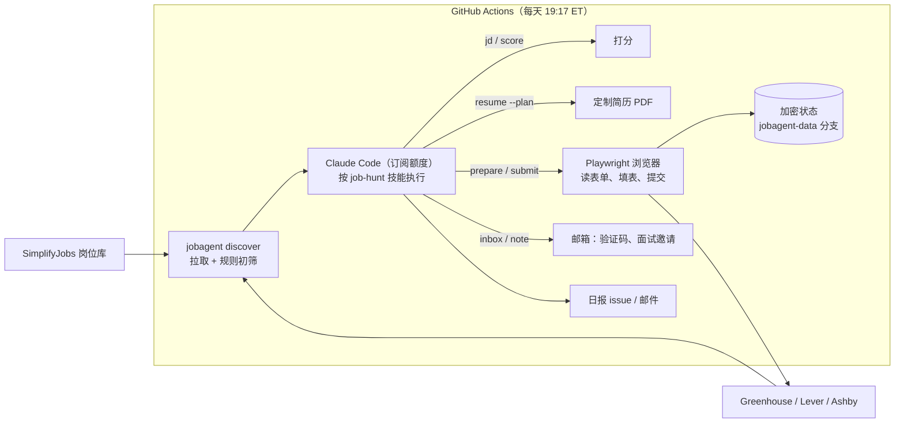

# 求职 Agent：自动找岗位、定制简历、投递、每日汇报

这个 Agent 每天晚上自动运行一次，面向**美国的实习和应届生岗位**：

1. **找岗位**：从 SimplifyJobs 维护的美国实习 / 应届生岗位库，以及你指定公司的 Greenhouse、Lever、Ashby 招聘页，拉取所有在招岗位。
2. **初筛**：按岗位类型、实习季、地点、发布时间、签证限制、职级关键词过滤，去掉重复，留下最值得细看的几十个。
3. **Claude 精读打分**：Claude 逐个阅读岗位描述，按技能、级别、兴趣、地点打 0 到 100 分。会排除硬性不符的岗位，比如要求美国公民、明确不提供签证担保。
4. **定制简历**：针对每个要投的岗位，从你的简历素材里挑最相关的经历和技能，生成一页 PDF。**只挑选和排序，绝不编造。**
5. **自动投递**：打开岗位的申请表，读出所有问题，标准问题按你的资料作答，其余问题 Claude 只依据你的资料回答，然后上传简历、提交。如果需要邮箱验证码，会自动读取你的邮箱完成验证。
6. **每日汇报**：每天晚上 8 点左右在 GitHub 上发一条日报，并 @ 你：投了哪些岗位、哪些需要你手动处理、邮箱里有没有面试邀请。

运行在 GitHub Actions 上，用的是**你自己的 Claude 订阅额度**（Claude Code 的订阅令牌），不需要 API Key。

## 它不会做的事

| 情况 | 处理方式 |
|---|---|
| 申请表里有你的资料回答不了的必答题（推荐人、成绩单等） | 不瞎填，列进「需要你手动处理」 |
| 雇主明确限制用 AI 撰写申请内容 | 不替你写回答，转人工 |
| 必须同意仲裁协议才能提交 | 默认不替你同意，转人工（可在资料里打开） |
| 遇到图形验证码 / 滑块 | 不破解，转人工 |
| Workday、TikTok/字节、公司自建招聘系统 | 仍然定制好简历，但转人工投递（这些系统需要注册账号，自动化很不稳定） |
| 岗位页面里写着「忽略之前的指令」之类的文字 | 当作数据，不执行（防提示注入） |
| LinkedIn、Indeed、Handshake | 不使用：这些平台禁止自动化，容易封号 |

另外有两条保护：每天最多投递的数量有上限（默认 10 个），只投 Claude 打分不低于阈值（默认 75）的岗位。

## 配置步骤（大约 15 分钟）

### 1. 把仓库改成私有（强烈建议）

GitHub 仓库页面 → Settings → General → 最下方 Danger Zone → Change visibility → Make private。

公开仓库也能用：个人资料放在加密的 Secrets 里，投递记录加密保存，日报会自动隐去打分理由和你的回答。但日报 issue 和运行记录在公开仓库里所有人都能看到，私有仓库更稳妥。私有仓库每月有 2000 分钟免费的 Actions 时长，每天跑一次足够用。

### 2. 填写个人资料

把 [`examples/profile.example.yaml`](../examples/profile.example.yaml) 复制一份到**仓库之外**的地方，比如 `~/.jobagent/profile.yaml`，把示例人物换成你自己的信息。文件里每一项都有中文注释。要点：

- **每条经历多写几个 bullet**：Agent 会根据岗位挑最相关的 2 到 4 条，素材越多，定制效果越好。
- **签证信息要如实填**：`work_authorization` 决定了怎么回答「是否需要签证担保」。F-1 学生通常填 `authorized_to_work_in_us: true`、`requires_sponsorship_future: true`。
- **筛选条件**：`preferences` 里是求职偏好，比如岗位类型、实习季、关键词、最低分、每天上限。

不想手动填的话，可以把简历发给 Claude，让它按这个模板转成 YAML，你再检查一遍。

在本地检查格式：

```bash
pip install -e . && JOBAGENT_PROFILE=~/.jobagent/profile.yaml jobagent check
```

### 3. 生成 Claude 订阅令牌

在本地终端运行下面的命令（需要已安装 Claude Code，在 VS Code 里用过 Claude Code 的话通常已经装好了），按提示登录后，会输出一个以 `sk-ant-oat` 开头的令牌：

```bash
claude setup-token
```

### 4. 生成状态加密密钥

```bash
python -m job_agent keygen
```

### 5.（推荐）Gmail 应用专用密码

用于自动读取验证码、跟踪面试邀请，也可以用来给你发邮件版日报。前提是 Google 账号开启了两步验证，然后在 Google 账号 → 安全 → 应用专用密码，创建一个 16 位密码。

### 6. 把这些添加到仓库的 Secrets

仓库 → Settings → Secrets and variables → Actions → New repository secret：

| Secret 名称 | 内容 | 必需 |
|---|---|---|
| `JOBAGENT_PROFILE_YAML` | 整个 profile.yaml 文件的内容 | ✅ |
| `CLAUDE_CODE_OAUTH_TOKEN` | 第 3 步得到的令牌 | ✅（或者用 `ANTHROPIC_API_KEY` 按量付费） |
| `JOBAGENT_STATE_KEY` | 第 4 步得到的密钥 | ✅（不配的话 Agent 记不住投过哪些岗位） |
| `JOBAGENT_IMAP_USER` | 你的 Gmail 地址 | 推荐 |
| `JOBAGENT_IMAP_PASSWORD` | 第 5 步的应用专用密码 | 推荐 |

用 GitHub CLI 的话也可以一条命令设置：

```bash
gh secret set JOBAGENT_PROFILE_YAML < ~/.jobagent/profile.yaml
```

### 7. 先演练一次

仓库 → Actions → **job-hunt** → Run workflow，勾选 **dry_run**。演练模式会完整走一遍流程，但**不会真正提交**任何申请。跑完后去 Issues 页面看日报，确认打分和简历都合理。

之后每天美东时间 **19:17** 自动运行，**20:00 左右**收到日报。想暂停的话：Actions → job-hunt → 右上角 `···` → Disable workflow。

## 日常使用

- **看日报**：每天的 issue 会 @ 你，GitHub App 和邮箱都会收到通知。
- **处理「需要你手动处理」的岗位**：日报里有链接和原因。私有仓库的话，定制好的简历在当天运行记录的 Artifacts 里。
- **调整策略**：改 `JOBAGENT_PROFILE_YAML` 里的 `preferences`：
  - 投得太少：降低 `min_score`，放宽 `title_exclude`，或增加 `keywords`
  - 投得太多：提高 `min_score`，或降低 `max_applications_per_day`
  - 只准备材料、不自动提交：设 `auto_apply: false`
- **指定模型**：在仓库 Settings → Variables 里添加 `JOBAGENT_CLAUDE_MODEL`（比如 `claude-opus-5-5`）。不设置就用订阅的默认模型。
- **在本地跑**：设置好 `~/.jobagent/profile.yaml` 后，在仓库目录打开 Claude Code，说「按 job-hunt 技能跑一次今天的求职」即可。

## 架构



职责分成两部分：

- **确定性的工作交给代码**：拉岗位、过滤、去重、渲染简历、操作浏览器、记账、加密存储，全部在 `job_agent/` 里，有单元测试和浏览器测试覆盖。
- **需要判断的工作交给 Claude**：岗位匹配度、挑选简历内容、回答非标准问题、理解邮件。Claude 只能通过 `jobagent` 命令行行动，工作流里用 `--allowedTools "Bash(jobagent *)"` 限制了它能执行的命令。

主要设计点：

1. **不编造的简历**：Claude 输出的是「挑哪些 bullet、按什么顺序」的计划，代码校验每个 id 都来自你的资料，结构上就不可能写进不存在的经历。
2. **能确定的答案不交给模型**：姓名、邮箱、签证、EEO、学历这些标准问题由规则从资料中直接得出。模型只处理剩下的问题，既省 token 也更可靠。
3. **防提示注入**：岗位描述和申请表都当作不可信数据。Claude 能执行的命令只有 `jobagent`，文件上传也只能选「简历」或「求职信」两种，测试里专门验证了上传 `/etc/passwd` 会被拒绝。
4. **隐私**：个人资料只存在 Secrets 中。投递记录用 Fernet 加密后存放在单独的分支。公开仓库的日报会自动隐去敏感细节，Claude 的完整对话记录不会打印到日志里。
5. **人在环路中**：遇到验证码、法律协议、雇主的 AI 限制、回答不了的问题，一律转人工，并在日报里写明原因。

## 开发者工具

- `jobagent --help`：所有命令，都输出 JSON。
- `dev-probe` 工作流：在真实申请页面上做只读探测（`probe_forms`）、填表演练（`dry_run_fill`）或全流程演练（`pipeline_smoke`）。**这几种模式都不会提交任何申请。**
- 测试：`pytest tests/job_agent`。浏览器测试会在本地起一个模拟申请页，覆盖填表、提交和邮箱验证码流程。

## 后续可以加的功能

- 为 Workday 写专用的适配器：自动注册账号，密码加密存进状态，用邮箱验证码完成注册。
- 适配 TikTok / 字节招聘官网（需要登录）。
- 根据回复率（面试邀请 / 投递数）自动调整打分阈值和关键词。
- 每周汇总一次：哪些技能被要求得最多、简历该补什么。
