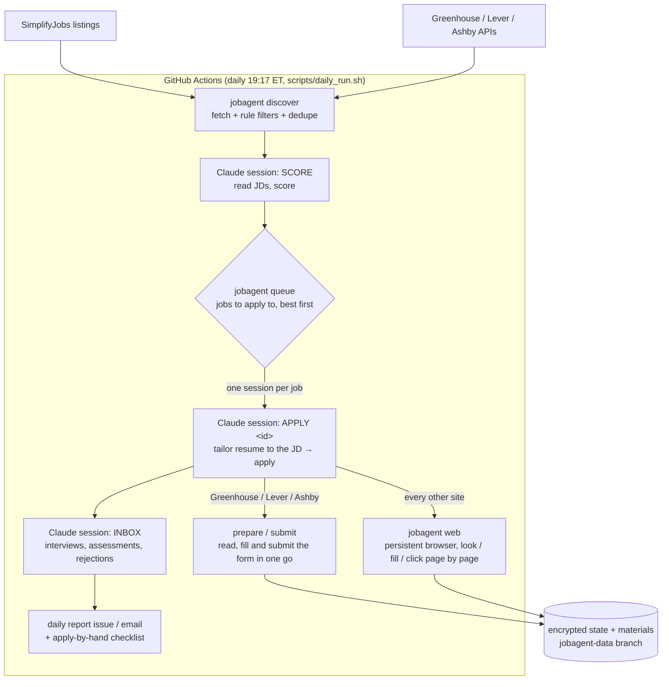
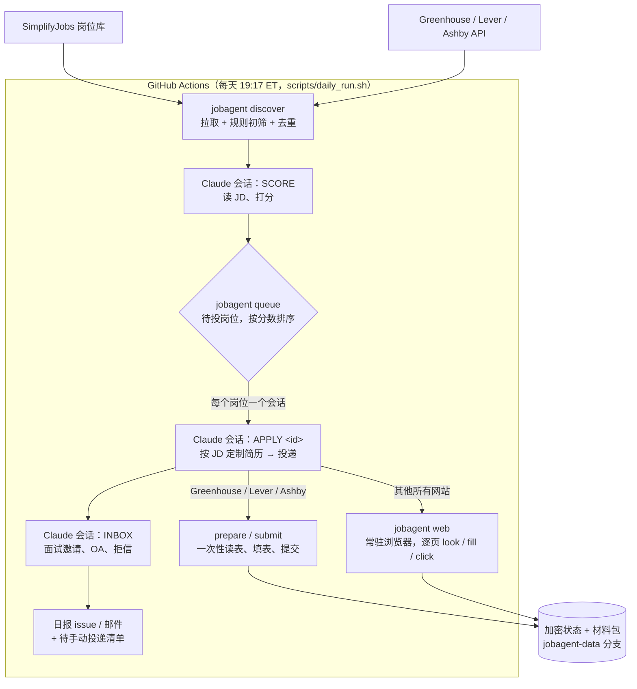

# Job Agent: design and implementation

**[English](#english) · [中文说明](#中文)**

## English

Installation and usage: see the [README](../README.md). This page explains how the agent works and why it is built this way.

### Architecture

Who does what:

- **Code does the deterministic work**: fetching jobs, filtering, deduplication, rendering resumes, checking rewrites, driving the browser, answering standard questions by rule, bookkeeping, encrypted storage. All of it lives in `job_agent/`, covered by unit and browser tests.
- **Claude does the judgment**: how well a job fits, which resume content to pick and how to phrase it, answers to non-standard questions, step-by-step navigation of unfamiliar sites, reading emails. Claude can only run `jobagent` commands (`--allowedTools "Bash(jobagent *)"`) and has no web tools.

#### Why one Claude session per job

With no application cap, a day can mean dozens of applications, each with dozens of steps. In one session the context keeps growing, later applications get worse, and one failure drags down the rest. `scripts/daily_run.sh` starts a separate session per job (at most 150 turns, 25 minutes) and then runs `jobagent settle` as a safety net:

- a job whose submit button was pressed (`submit_clicked.txt`, written just before the click) but whose result was never recorded may have gone through: it is **never retried automatically**; it goes on the apply-by-hand list with a note to check your email first;
- a job interrupted because the Claude quota ran out or the token was rejected stays in the queue for the next run;
- a timeout or crash (non-zero exit) gets one more try in the next run (`Job.retries`, at most 1);
- in a rehearsal (`JOBAGENT_DRY_RUN=1`), prepared jobs go back to the queue for the first real run;
- anything else without a result goes on the apply-by-hand list.

Models: Sonnet for scoring, the inbox and most applications; Opus for jobs scoring at least `JOBAGENT_TOP_SCORE` (85), where tailoring and written answers matter most. If an Opus session stops on a usage limit, the same job is retried on Sonnet at once and the rest of the day stays on Sonnet; only when Sonnet is out of quota too does the run stop. `JOBAGENT_CLAUDE_MODEL` overrides all of this with one model.

The queue (`jobagent queue`) is ordered by score plus a freshness bonus (+8 if posted within 24 hours, +4 within 3 days). There is no per-company limit by default; with `max_per_company` set, at most that many applications go to one company within 30 days, and the rest are recorded as skipped with the reason.

#### Two ways to apply

1. **Form flow** (Greenhouse, Lever, Ashby; about a third of the listings): `prepare` reads the whole form and attaches a suggested answer from the profile to each field; Claude answers the rest; `submit` fills, re-checks and submits it in a fresh browser and recognises the outcome (confirmation page, CAPTCHA challenge, email code).
2. **Browser flow** (Workday, iCIMS, SmartRecruiters, TikTok, company portals...): `jobagent web` keeps one Chromium running in the background (over CDP). At each step Claude calls `look` to see the page (fields, buttons, alerts, text), `fill` to fill it, `click` to press buttons, `code` / `link` to finish email verification, and finally `finish` to record the outcome.

Both share one field extractor (`browser/extract.js`) and one set of answer rules (`browser/forms.py`). They handle Greenhouse's react-select, Ashby's Yes/No buttons and per-render ids, Lever's card questions and Workday-style pop-up lists, and they know which fields are already filled.

### Where answers come from (highest priority first)

1. `custom_answers`: your own "question regex → answer" pairs, which override everything.
2. Built-in rules answered from the profile: name, contact details, education, visa and sponsorship, citizenship / green card / export-control "U.S. person" status, nationality of embargoed countries, declarations made in advance (criminal record, background check, drug test, non-compete...), EEO (default: decline to self-identify), terms / arbitration / privacy notices (accepted).
3. Learned answers: what Claude answered before to the same question (`memory.py`). Only choices and short answers are kept, never personalised essays or answers that name a company.
4. Claude answers on the spot, only from the profile and `about_me`; short essays are written for the specific job description.
5. A required question nothing can answer → the job goes on the apply-by-hand list, naming the question.

Statements of fact are never ticked as if they were agreements, e.g. "I am a U.S. citizen" or "I certify these answers were written without AI".

Questions asked the other way round, such as "Can you work in the U.S. without sponsorship?", get the inverted answer (`WITHOUT_SPONSORSHIP`).

#### Checked before submitting (`forms.audit`)

After AutoApply's read-back before submit: `extract.js` reads what each field currently shows (`shown`; never passwords). If any factual answer that comes from the profile (`work_authorization.*`, `declarations.*`, `custom_answers`, over 18, name, email) contradicts what the page shows (yes vs no, a different option, another email address; formatting never counts), nothing is submitted:

- form flow: `submit` returns `incomplete` when one of Claude's answers contradicts the profile, and after filling it reads the page again, returning `fill_failed` if a dropdown picked the wrong option;
- browser flow: `web click` checks first when it recognises a submit button and refuses on a contradiction; `web fill --overwrite` puts the profile's answers back.

Claude uses `--force` to skip the check only after re-reading the question and finding that the rule misread it (e.g. a double negative).

Submit buttons are recognised by more than their label: a `type=submit` button, or a button without a type inside a form, counts too (after AIHawk), unless it is a Next / Save and Continue step; a plain link to another page only navigates and does not count. Dry runs are enforced on this basis.

Filling a form must never submit it either: when a searchable dropdown has no matching option, the filler presses Escape rather than Enter (Enter in a form field submits the form), and before clicking a Yes/No button group it turns type-less buttons into plain buttons (HTML treats them as submit buttons). Both have regression tests (`enter.html`).

### Resume tailoring: fitted to the JD, never invented

Claude produces a plan (`plan.json`): which experiences and bullets, in what order, which skills, and optionally a rewording of a bullet or the summary that mirrors the posting. `resume.py` checks the plan:

- every id must come from your profile;
- a rewrite may not contain numbers the original lacks;
- nor technologies, products or organisations that appear nowhere in the profile (turning "35%" into "50%", or adding "at Meta", is rejected);
- lengths are capped.

Every application gets its own resume. The job-hunt skill walks Claude through it like a resume writer for software roles: read the posting's must-haves and wording, pick and order the bullets that prove them (the top third of the page matters most), reword with strong verbs and the posting's terms without changing facts, list matching skills first. After each build, `jobagent resume` reports `jd_terms_in_profile_but_not_in_resume`: technologies the posting asks for that the profile supports but this resume does not show yet.

It renders a single-column, ATS-friendly one-page Letter PDF in the style of the LaTeX "Jake's Resume" template, with the Computer Modern font (CMU Serif, OFL, embedded from `job_agent/resume_fonts/`). If the content runs past one page, the layout tightens step by step (font size, line height, margins; down to 9.3pt) before any bullet has to go.

Salary questions use `answers.salary_expectation`, or `answers.salary_expectation_if_posted` when the job description states its pay.

### Safety

- **Prompt injection**: job descriptions and application pages are untrusted data. Claude has no web tools; personal data can only be typed into the employer's own domain or a known applicant system (`web.allowed`); uploads are limited to the generated resume or cover letter.
- **Passwords**: `vault.py` generates a strong 20-character password per site, with your email as the username, keeps it in the encrypted state and types it directly; Claude only sees a placeholder. The command that shows passwords refuses to run in CI.
- **Dry runs**: with `JOBAGENT_DRY_RUN=1` the CLI itself refuses to submit, refuses to press "create account / submit" buttons and never generates real passwords, even if Claude forgets `--dry-run`. The first scheduled run is always a rehearsal.
- **Privacy**: the profile lives only in Secrets. State and materials are Fernet-encrypted on a separate branch. Public repositories never print Claude's transcripts, and their reports leave out score reasons.
- **CAPTCHAs are never solved**; the job goes to you.
- **No permissions, no identity checks, no payments** (after ApplyPilot's "NEVER DO" list): the browser starts with `--deny-permission-prompts`, so camera, microphone and location requests are refused; video / selfie / ID verification, contract-marketplace sign-ups, fees and downloads all go to you.

### Closed postings and duplicate applications

- When `jobagent jd` reads a description and the Greenhouse / Lever API answers 404/410, or the page itself says the job no longer takes applications, the job is recorded as `closed`: no score, not on your list. (A Workday API 404 can come from an unusual URL shape, so Workday postings are judged by their page.)
- In the browser flow, `look` reports `looks_closed` (posting closed) and `already_applied` (the site says you applied before); Claude records them with `web finish closed` / `web finish duplicate`.
- `web finish applied` records the confirmation page's URL and whether it showed clear confirmation text (`confirmed_by_page`); if not, the report asks you to watch for the confirmation email.

### Pre-filtering (before scoring, no quota used)

Besides job type, term, location, visa restrictions, posting age and duplicates, titles are filtered too (after AutoApply's `hard_filter`):

- a term in the title that is not the one you want (you want Summer 2027; the title says Fall 2026 or 2026 Intern; graduation years such as "Class of 2028" do not count). The term SimplifyJobs lists wins over the title;
- undergraduates only / graduate students only / PhD only (judged by your most recent degree; "MS/PhD" is not PhD only);
- one school's students ("University of X students"), one career fair (Grace Hopper, AfroTech...), talent pools ("Talent Community");
- contract / crowd-work marketplaces (Mercor, Toptal, Upwork, Outlier...): signing up there is not applying for a job.

### The daily report

By default the report is a GitHub issue that @-mentions you (and optionally an email); boxes ticked in it mark jobs you applied to by hand. With `notify.github_issue: false` it goes by email only: no issue (old report issues are closed), numbered jobs on the apply-by-hand list, and replies such as `done 3 7` from your own address mark them (`jobagent sync-checklist` reads them over IMAP; quoted text from the original email is ignored). `daily_run.sh` numbers its sessions (`apply-1`, `apply-2`...) instead of printing job ids, because Actions logs of public repositories are public.

### Quota and token problems

`daily_run.sh` recognises these Claude Code errors: subscription limit reached, API credit exhausted, token invalid or expired. It stops at once, says so at the top of the report, keeps unfinished jobs queued and continues in the next run. `tests/job_agent/test_daily_run.py` covers each case with a stand-in `claude`, including running out halfway through applications.

### Tests

| Test | What it covers |
|---|---|
| `tests/job_agent/test_core.py` | job parsing, filters, dedupe, state encryption, resume plans and rewrite checks, answer rules, learned answers, CSV |
| `tests/job_agent/test_browser.py` | a local mock form: fill, submit, email code, account creation, enforced dry run |
| `tests/job_agent/test_web.py` | a local Workday-style multi-step flow: sign-up, code, two form steps, review, submit; dry-run blocking; personal-data allowlist |
| `tests/job_agent/test_daily_run.py` | quota reached / credit exhausted / token expired, and quota running out mid-way |
| `tests/job_agent/test_round4.py` | checks before submitting (wrong option, contradictions, `--force`), submit-button detection, closed postings, no re-apply after a submit click, one retry after a timeout, rehearsed jobs kept queued, company limit and queue order, title filters, report flags, forms never submitted while filling |
| `dev-probe` workflow | on real sites: read-only probing (`probe_forms`), fill rehearsal (`dry_run_fill`), whole-pipeline rehearsal (`pipeline_smoke`), browser-flow probing (`web_smoke`); none of them submits |

During development the full `daily_run.sh` also ran with real Claude: on mock sites, a Greenhouse-style form and a Workday-style multi-step flow were submitted, and a job requiring citizenship and one with a prompt injection in its description were skipped; on real postings (rehearsal, fictional profile), Claude scored 30 job descriptions and filled 7 Greenhouse / Lever / Ashby applications up to the submit button.

---

## 中文

安装和使用见 [README](../README.md)。这里讲它是怎么工作的、为什么这样设计。

### 架构

分工：

- **代码负责确定性的工作**：拉岗位、过滤、去重、渲染简历、校验改写、操作浏览器、按规则回答标准问题、记账、加密存储。全部在 `job_agent/` 里，有单元测试和浏览器测试。
- **Claude 负责需要判断的工作**：岗位匹配度、挑选和改写简历内容、回答非标准问题、在陌生网站上一步步操作、理解邮件。Claude 只能执行 `jobagent` 命令（`--allowedTools "Bash(jobagent *)"`），没有任何联网工具。

#### 为什么每个岗位一个 Claude 会话

不设投递上限后，一天可能要投几十个岗位，每个多步申请要几十次操作。放在同一个会话里，上下文会越积越长，后面的岗位质量下降，一处出错也会拖累全部。`scripts/daily_run.sh` 给每个岗位单独起一个会话（上限 150 轮、25 分钟），结束后用 `jobagent settle` 兜底：

- 已经按下过提交按钮（`submit_clicked.txt` 标记，按下之前写入）但没记录结果的岗位，可能已经投出去了，**绝不自动重投**，转入手动清单并提示先查邮箱；
- 因为额度用完或令牌失效而中断的，留到下次运行；
- 超时或崩溃（退出码非 0）的，下次运行再试一次（`Job.retries`，最多 1 次）；
- 演练模式（`JOBAGENT_DRY_RUN=1`）下准备好的岗位放回队列，等第一次正式运行再投；
- 其余没给出结果的，转入手动清单。

模型：打分、读邮箱和大部分投递用 Sonnet；匹配度达到 `JOBAGENT_TOP_SCORE`（85）的岗位用 Opus，因为这些岗位的简历定制和开放题回答最值得投入。Opus 会话撞上额度上限时，同一个岗位立刻改用 Sonnet 重做，当天剩下的也都用 Sonnet；Sonnet 也没额度了才停止。设置 `JOBAGENT_CLAUDE_MODEL` 则所有环节都用这一个模型。

投递队列（`jobagent queue`）按「匹配分 + 新鲜度加成」排序（24 小时内发布 +8，3 天内 +4），默认不限制同一家公司的投递数；设了 `max_per_company` 的话，同一家公司 30 天内最多投这么多个，超出的记为跳过并写明原因。

#### 两种投递方式

1. **表单流程**（Greenhouse、Lever、Ashby，约占岗位库的三分之一）：`prepare` 读出整张表单，每个字段附上从资料推出的建议答案；Claude 补上剩下的，`submit` 在新开的浏览器里一次性填写、复查、提交，并识别提交结果（成功页面、验证码挑战、邮箱验证码）。
2. **浏览器流程**（Workday、iCIMS、SmartRecruiters、TikTok、公司官网等）：`jobagent web` 让一个 Chromium 在后台常驻（CDP 连接），Claude 每一步调用 `look` 看页面（字段、按钮、提示、正文），用 `fill` 填写，用 `click` 按钮，用 `code` / `link` 完成邮箱验证，最后用 `finish` 记录结果。

两种方式共用同一个字段识别器（`browser/extract.js`）和答案规则（`browser/forms.py`）。它们适配了 Greenhouse 的 react-select、Ashby 的 Yes/No 按钮和每次加载都会变的 id、Lever 的卡片题、Workday 式弹出列表，并会识别每个字段当前是否已填好。

### 回答从哪来（优先级从高到低）

1. `custom_answers`：你自己写的「问题正则 → 答案」，覆盖一切。
2. 内置规则：根据资料作答，包括姓名、联系方式、学历、签证与担保、公民 / 绿卡 / 出口管制意义上的 "U.S. person"、受制裁国家国籍、事先声明（犯罪记录、背调、药检、竞业等）、EEO（默认选「不愿透露」）、服务条款 / 仲裁 / 隐私协议（自动同意）。
3. 学到的回答：Claude 以前对同一问题的回答（`memory.py`），只记选择题和短答，不记个性化长文和提到公司名的回答。
4. Claude 现场作答：只依据资料和 `about_me`；写申请短文时贴合 JD。
5. 都答不了的必答题 → 转入手动清单，并写明是哪道题。

事实性声明不会被当成「同意协议」自动勾选，比如「我是美国公民」，或者「我声明这些回答没有使用 AI」。

「不需要 sponsor 也能在美国工作吗？」这类反过来问的题，规则会自动把答案反过来（`WITHOUT_SPONSORSHIP`）。

#### 提交前核对（`forms.audit`）

参考 AutoApply 的「提交前回读」：`extract.js` 会读出每个字段当前显示的值（`shown`，密码除外）。凡是来自资料的事实性答案（`work_authorization.*`、`declarations.*`、`custom_answers`、年满 18 岁、姓名、邮箱），只要页面显示的值和资料矛盾（是/否相反、选了别的选项、邮箱不同；格式差异不算），就不提交：

- 表单流程：Claude 的答案和资料矛盾时 `submit` 返回 `incomplete`；填完之后再读一遍页面，选错了下拉项会返回 `fill_failed`；
- 浏览器流程：`web click` 识别出这是提交按钮时先核对，矛盾就拒绝点击，`web fill --overwrite` 可以换回资料里的答案。

只有在 Claude 重新读题、确认规则读错了题意（比如双重否定）时，才用 `--force` 越过核对。

提交按钮的识别不只看文字：`type=submit` 的按钮、表单里没写 type 的按钮也算（参考 AIHawk），除非它是 Next / Save and Continue 这类翻页按钮；指向另一个页面的普通链接只是跳转，不算。演练模式据此拦截。

填表本身也不能意外提交：下拉搜索框没有匹配项时按 Esc 而不是回车（表单里的回车会直接提交）；点 Yes/No 按钮组之前，把表单里没写 type 的按钮改成普通按钮（HTML 默认它是提交按钮）。这两个问题都有回归测试（`enter.html`）。

### 简历定制：贴合 JD，但不编造

Claude 输出的是一份计划（`plan.json`）：选哪些经历和 bullet、什么顺序、列哪些技能，并且可以把某条 bullet 或总结改写成更贴近 JD 的说法。`resume.py` 会校验这份计划：

- 选的 id 必须来自你的资料；
- 改写后不能出现原文没有的数字；
- 不能出现资料里任何地方都没有的技术、产品或机构名（比如把「35%」改成「50%」，或者加上「at Meta」，都会被拒绝）；
- 长度有上限。

每个申请都单独定制简历。job-hunt 手册让 Claude 像专业的 SDE 简历顾问一样做：先读出 JD 的硬性要求和用词，再挑选、排序最能证明这些要求的 bullet（页面上方三分之一最关键），用有力的动词和 JD 的术语改写但不改事实，技能里匹配的排在前面。每次生成后，`jobagent resume` 会报告 `jd_terms_in_profile_but_not_in_resume`：JD 要求、你资料里也有、但这份简历还没体现的技术。

渲染成单栏、ATS 友好的一页 Letter PDF，版式仿 LaTeX 的 "Jake's Resume" 模板，字体是 Computer Modern（CMU Serif，OFL 开源许可，内嵌自 `job_agent/resume_fonts/`）。内容超过一页时，先逐级收紧字号、行距和页边距（最小 9.3pt），还放不下才删 bullet。

薪资题用 `answers.salary_expectation`；JD 写明薪资时改用 `answers.salary_expectation_if_posted`。

### 安全

- **提示注入**：JD 和申请页都是不可信数据。Claude 没有联网工具；个人信息只能填进招聘方自己的域名或已知招聘系统（`web.allowed`）；文件上传只能选生成的简历或求职信。
- **密码**：`vault.py` 为每个网站生成 20 位强密码，用你的邮箱作为用户名，存在加密状态里，由程序直接输入，Claude 只能看到占位符。查看密码的命令在 CI 里会拒绝执行。
- **演练模式**：设置 `JOBAGENT_DRY_RUN=1` 时，CLI 本身拒绝提交、拒绝点击「创建账号 / 提交」类按钮、不生成真实密码。即使 Claude 忘了加 `--dry-run` 也一样，第一次定时运行自动按演练处理。
- **隐私**：资料只放在 Secrets 里。状态和材料用 Fernet 加密后存放在单独分支。公开仓库不打印 Claude 的对话记录，日报也不包含打分理由。
- **不破解验证码**，遇到就转人工。
- **不授权、不验证、不付费**（参考 ApplyPilot 的「NEVER DO」清单）：浏览器用 `--deny-permission-prompts` 启动，摄像头、麦克风、定位等权限请求一律拒绝；视频 / 自拍 / 证件验证、外包平台注册、付费、下载安装都转人工。

### 岗位关闭和重复投递

- `jobagent jd` 读 JD 时，Greenhouse / Lever 接口返回 404/410，或者页面本身就是「已停止招聘」，岗位直接记为 `closed`，不再打分、不进手动清单。（Workday 接口的 404 可能只是网址格式少见，所以 Workday 岗位只看页面本身。）
- 浏览器流程里，`look` 返回 `looks_closed`（岗位已关闭）和 `already_applied`（网站说你投过），Claude 用 `web finish closed` / `web finish duplicate` 记录。
- `web finish applied` 会记录确认页地址，并标注页面上是否出现了明确的确认文字（`confirmed_by_page`）；没有的话日报里提示留意确认邮件。

### 初筛（打分之前，不花额度）

除了岗位类型、实习季、地点、签证限制、发布时间、重复岗位，还会按标题过滤（参考 AutoApply 的 `hard_filter`）：

- 标题写的学期和你要的不一致（如要 Summer 2027，标题是 Fall 2026 或 2026 Intern；「Class of 2028」这种毕业年份不算）。SimplifyJobs 标注的学期优先于标题；
- 只招本科生 / 只招研究生 / 只招 PhD（按你最近一个学位判断，「MS/PhD」不算只招 PhD）；
- 只面向某个学校（「University of X students」）或某个招聘会（Grace Hopper、AfroTech 等）、人才库（Talent Community）；
- 外包 / 众包平台（Mercor、Toptal、Upwork、Outlier 等），注册它们不是在投递工作。

### 日报

默认日报是 GitHub issue 并 @ 你（可同时发邮件），在 issue 里勾选表示你已手动投递。设 `notify.github_issue: false` 后只发邮件：不发 issue（旧的日报 issue 会关闭），手动清单里的岗位带编号，你从自己的邮箱回复 `done 3 7` 这样的内容即可标记（`jobagent sync-checklist` 通过 IMAP 读取，原邮件的引用部分会被忽略）。`daily_run.sh` 打印会话时只用编号（`apply-1`、`apply-2`……），不打印岗位 id，因为公开仓库的运行日志所有人可见。

### 额度和令牌问题

`daily_run.sh` 会识别 Claude Code 的这几类报错：订阅额度上限、API 余额不足、令牌失效或过期。识别到后立即停止，把原因写到日报顶部，没完成的岗位保持「待投」，下次运行接着做。`tests/job_agent/test_daily_run.py` 用一个假的 `claude` 程序覆盖了这几种情况，包括投到一半额度用完。

### 测试

| 测试 | 内容 |
|---|---|
| `tests/job_agent/test_core.py` | 岗位解析、筛选、去重、状态加密、简历计划与改写校验、各类回答规则、学到的回答、CSV |
| `tests/job_agent/test_browser.py` | 本地模拟表单：填表、提交、邮箱验证码、注册账号、强制演练 |
| `tests/job_agent/test_web.py` | 本地模拟的 Workday 式多步流程：注册、验证码、两步表单、审核、提交；演练拦截；个人信息白名单 |
| `tests/job_agent/test_daily_run.py` | 额度用完 / 余额不足 / 令牌过期，以及投到一半额度用完 |
| `tests/job_agent/test_round4.py` | 提交前核对（选错项、资料矛盾、`--force`）、提交按钮识别、岗位关闭识别、按过提交不重投、超时重试一次、演练过的岗位留在队列、公司上限和队列顺序、标题初筛、日报标注、填表时绝不意外提交 |
| `dev-probe` 工作流 | 在真实网站上只读探测（`probe_forms`）、填表演练（`dry_run_fill`）、全流程演练（`pipeline_smoke`）、浏览器流程只读探测（`web_smoke`），都不会提交 |

开发过程中还用真实的 Claude 跑过完整的 `daily_run.sh`：在模拟网站上，Greenhouse 式表单和 Workday 式多步流程都成功提交，要求公民身份的岗位和岗位描述里埋了提示注入的岗位都被正确跳过；在真实岗位上（演练模式、虚构资料），Claude 读了 30 份 JD 并打分，把 7 个 Greenhouse / Lever / Ashby 申请填到了提交按钮前。
