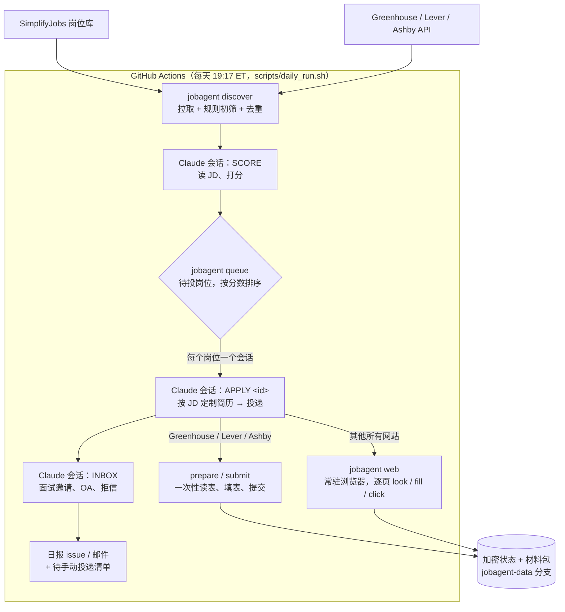

# 求职 Agent：设计与实现

安装和使用见 [README](../README.md)。这里讲它是怎么工作的、为什么这样设计。

## 架构

分工：

- **代码负责确定性的工作**：拉岗位、过滤、去重、渲染简历、校验改写、操作浏览器、按规则回答标准问题、记账、加密存储。全部在 `job_agent/` 里，有单元测试和浏览器测试。
- **Claude 负责需要判断的工作**：岗位匹配度、挑选和改写简历内容、回答非标准问题、在陌生网站上一步步操作、理解邮件。Claude 只能执行 `jobagent` 命令（`--allowedTools "Bash(jobagent *)"`），没有任何联网工具。

### 为什么每个岗位一个 Claude 会话

不设投递上限后，一天可能要投几十个岗位，每个多步申请要几十次操作。放在同一个会话里，上下文会越积越长，后面的岗位质量下降，一处出错也会拖累全部。`scripts/daily_run.sh` 给每个岗位单独起一个会话（上限 150 轮、25 分钟），结束后用 `jobagent settle` 兜底：

- 已经按下过提交按钮（`submit_clicked.txt` 标记，按下之前写入）但没记录结果的岗位，可能已经投出去了，**绝不自动重投**，转入手动清单并提示先查邮箱；
- 因为额度用完或令牌失效而中断的，留到下次运行；
- 超时或崩溃（退出码非 0）的，下次运行再试一次（`Job.retries`，最多 1 次）；
- 其余没给出结果的，转入手动清单。

投递队列（`jobagent queue`）按「匹配分 + 新鲜度加成」排序（24 小时内发布 +8，3 天内 +4），默认不限制同一家公司的投递数；设了 `max_per_company` 的话，同一家公司 30 天内最多投这么多个，超出的记为跳过并写明原因。

### 两种投递方式

1. **表单流程**（Greenhouse、Lever、Ashby，约占岗位库的三分之一）：`prepare` 读出整张表单，每个字段附上从资料推出的建议答案；Claude 补上剩下的，`submit` 在新开的浏览器里一次性填写、复查、提交，并识别提交结果（成功页面、验证码挑战、邮箱验证码）。
2. **浏览器流程**（Workday、iCIMS、SmartRecruiters、TikTok、公司官网等）：`jobagent web` 让一个 Chromium 在后台常驻（CDP 连接），Claude 每一步调用 `look` 看页面（字段、按钮、提示、正文），用 `fill` 填写，用 `click` 按钮，用 `code` / `link` 完成邮箱验证，最后用 `finish` 记录结果。

两种方式共用同一个字段识别器（`browser/extract.js`）和答案规则（`browser/forms.py`）。它们适配了 Greenhouse 的 react-select、Ashby 的 Yes/No 按钮和每次加载都会变的 id、Lever 的卡片题、Workday 式弹出列表，并会识别每个字段当前是否已填好。

## 回答从哪来（优先级从高到低）

1. `custom_answers`：你自己写的「问题正则 → 答案」，覆盖一切。
2. 内置规则：根据资料作答，包括姓名、联系方式、学历、签证与担保、公民 / 绿卡 / 出口管制意义上的 "U.S. person"、受制裁国家国籍、事先声明（犯罪记录、背调、药检、竞业等）、EEO（默认选「不愿透露」）、服务条款 / 仲裁 / 隐私协议（自动同意）。
3. 学到的回答：Claude 以前对同一问题的回答（`memory.py`），只记选择题和短答，不记个性化长文和提到公司名的回答。
4. Claude 现场作答：只依据资料和 `about_me`；写申请短文时贴合 JD。
5. 都答不了的必答题 → 转入手动清单，并写明是哪道题。

事实性声明不会被当成「同意协议」自动勾选，比如「我是美国公民」，或者「我声明这些回答没有使用 AI」。

「不需要 sponsor 也能在美国工作吗？」这类反过来问的题，规则会自动把答案反过来（`WITHOUT_SPONSORSHIP`）。

### 提交前核对（`forms.audit`）

参考 AutoApply 的「提交前回读」：`extract.js` 会读出每个字段当前显示的值（`shown`，密码除外）。凡是来自资料的事实性答案（`work_authorization.*`、`declarations.*`、`custom_answers`、年满 18 岁、姓名、邮箱），只要页面显示的值和资料矛盾（是/否相反、选了别的选项、邮箱不同；格式差异不算），就不提交：

- 表单流程：Claude 的答案和资料矛盾时 `submit` 返回 `incomplete`；填完之后再读一遍页面，选错了下拉项会返回 `fill_failed`；
- 浏览器流程：`web click` 识别出这是提交按钮时先核对，矛盾就拒绝点击，`web fill --overwrite` 可以换回资料里的答案。

只有在 Claude 重新读题、确认规则读错了题意（比如双重否定）时，才用 `--force` 越过核对。

提交按钮的识别不只看文字：`type=submit` 的按钮、表单里没写 type 的按钮也算（参考 AIHawk），除非它是 Next / Save and Continue 这类翻页按钮；指向另一个页面的普通链接只是跳转，不算。演练模式据此拦截。

填表本身也不能意外提交：下拉搜索框没有匹配项时按 Esc 而不是回车（表单里的回车会直接提交）；点 Yes/No 按钮组之前，把表单里没写 type 的按钮改成普通按钮（HTML 默认它是提交按钮）。这两个问题都有回归测试（`enter.html`）。

## 简历定制：贴合 JD，但不编造

Claude 输出的是一份计划（`plan.json`）：选哪些经历和 bullet、什么顺序、列哪些技能，并且可以把某条 bullet 或总结改写成更贴近 JD 的说法。`resume.py` 会校验这份计划：

- 选的 id 必须来自你的资料；
- 改写后不能出现原文没有的数字；
- 不能出现资料里任何地方都没有的技术、产品或机构名（比如把「35%」改成「50%」，或者加上「at Meta」，都会被拒绝）；
- 长度有上限。

渲染成单栏、ATS 友好的一页 Letter PDF。

## 安全

- **提示注入**：JD 和申请页都是不可信数据。Claude 没有联网工具；个人信息只能填进招聘方自己的域名或已知招聘系统（`web.allowed`）；文件上传只能选生成的简历或求职信。
- **密码**：`vault.py` 为每个网站生成 20 位强密码，用你的邮箱作为用户名，存在加密状态里，由程序直接输入，Claude 只能看到占位符。查看密码的命令在 CI 里会拒绝执行。
- **演练模式**：设置 `JOBAGENT_DRY_RUN=1` 时，CLI 本身拒绝提交、拒绝点击「创建账号 / 提交」类按钮、不生成真实密码。即使 Claude 忘了加 `--dry-run` 也一样，第一次定时运行自动按演练处理。
- **隐私**：资料只放在 Secrets 里。状态和材料用 Fernet 加密后存放在单独分支。公开仓库不打印 Claude 的对话记录，日报也不包含打分理由。
- **不破解验证码**，遇到就转人工。
- **不授权、不验证、不付费**（参考 ApplyPilot 的「NEVER DO」清单）：浏览器用 `--deny-permission-prompts` 启动，摄像头、麦克风、定位等权限请求一律拒绝；视频 / 自拍 / 证件验证、外包平台注册、付费、下载安装都转人工。

## 岗位关闭和重复投递

- `jobagent jd` 读 JD 时，Greenhouse / Lever / Workday 接口返回 404/410，或者页面本身就是「已停止招聘」，岗位直接记为 `closed`，不再打分、不进手动清单。
- 浏览器流程里，`look` 返回 `looks_closed`（岗位已关闭）和 `already_applied`（网站说你投过），Claude 用 `web finish closed` / `web finish duplicate` 记录。
- `web finish applied` 会记录确认页地址，并标注页面上是否出现了明确的确认文字（`confirmed_by_page`）；没有的话日报里提示留意确认邮件。

## 初筛（打分之前，不花额度）

除了岗位类型、实习季、地点、签证限制、发布时间、重复岗位，还会按标题过滤（参考 AutoApply 的 `hard_filter`）：

- 标题写的学期和你要的不一致（如要 Summer 2027，标题是 Fall 2026 或 2026 Intern；「Class of 2028」这种毕业年份不算）。SimplifyJobs 标注的学期优先于标题；
- 只招本科生 / 只招研究生 / 只招 PhD（按你最近一个学位判断，「MS/PhD」不算只招 PhD）；
- 只面向某个学校（「University of X students」）或某个招聘会（Grace Hopper、AfroTech 等）、人才库（Talent Community）；
- 外包 / 众包平台（Mercor、Toptal、Upwork、Outlier 等），注册它们不是在投递工作。

## 额度和令牌问题

`daily_run.sh` 会识别 Claude Code 的这几类报错：订阅额度上限、API 余额不足、令牌失效或过期。识别到后立即停止，把原因写到日报顶部，没完成的岗位保持「待投」，下次运行接着做。`tests/job_agent/test_daily_run.py` 用一个假的 `claude` 程序覆盖了这几种情况，包括投到一半额度用完。

## 测试

| 测试 | 内容 |
|---|---|
| `tests/job_agent/test_core.py` | 岗位解析、筛选、去重、状态加密、简历计划与改写校验、各类回答规则、学到的回答、CSV |
| `tests/job_agent/test_browser.py` | 本地模拟表单：填表、提交、邮箱验证码、注册账号、强制演练 |
| `tests/job_agent/test_web.py` | 本地模拟的 Workday 式多步流程：注册、验证码、两步表单、审核、提交；演练拦截；个人信息白名单 |
| `tests/job_agent/test_daily_run.py` | 额度用完 / 余额不足 / 令牌过期，以及投到一半额度用完 |
| `tests/job_agent/test_round4.py` | 提交前核对（选错项、资料矛盾、`--force`）、提交按钮识别、岗位关闭识别、按过提交不重投、超时重试一次、公司上限和队列顺序、标题初筛、日报标注 |
| `dev-probe` 工作流 | 在真实网站上只读探测（`probe_forms`）、填表演练（`dry_run_fill`）、全流程演练（`pipeline_smoke`）、浏览器流程只读探测（`web_smoke`），都不会提交 |

开发过程中还用真实的 Claude 在模拟网站上跑过完整的 `daily_run.sh`：Greenhouse 式表单和 Workday 式多步流程都成功提交；要求公民身份的岗位和岗位描述里埋了提示注入的岗位都被正确跳过。
